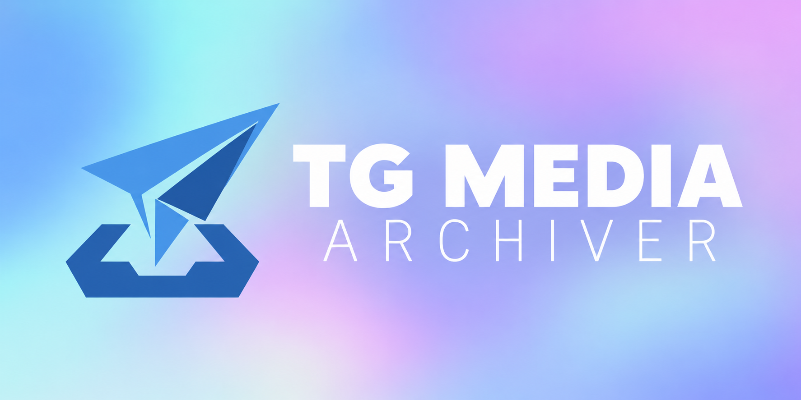

<div align="center">




README LANGUAGES [ [**English**](README.md) | [简体中文](README-zh.md) ]

</div>

# **TG Media Archiver**


_**Archive Telegram media forwarded to your bot on your own storage.**_

TG Media Archiver saves photos, videos, and documents forwarded by an authorized user in a private chat with the bot. Each media item, including each item in a mixed album, enters a download queue and is saved to a configured directory.

## Features

- **Private, authorized intake** — Only forwarded media from the signed-in owner in the bot's private chat is accepted.
- **Persistent queue** — Unfinished jobs are stored in SQLite and recovered after a restart. An interrupted file starts downloading again from the beginning.
- **Two-stage deduplication** — Check Telegram media identity before transfer, then compare SHA-256 after download. A duplicate is skipped only when its local file still exists and verifies. Identical content with a different Telegram identity must be downloaded before its hash can be compared.
- **Archive index refresh** — At startup, reconcile moved, imported, changed, and deleted files. Unchanged files reuse their saved hashes; moved files can still match their original Telegram identity through verified content.
- **On-demand progress** — `/progress` shows queued jobs, active files, transferred bytes, and speed for 10 seconds. It then becomes a quiet reminder with a button to reopen the live panel. While visible, the panel moves below new private-chat messages.
- **Task summaries** — Each completed batch receives one summary with downloaded, skipped, and failed counts. Later forwards form separate batches, and a failed item does not hold the summary indefinitely.
- **Chat cleanup** — After saving a file or verifying a duplicate, the corresponding forwarded copy is deleted from the private chat. Failed items remain available for retry.
- **Shared-storage permissions** — Published files retain the destination directory's inherited ACL for NAS file management.

## Installation

### Docker Compose

Images are available from GHCR for `linux/amd64` and `linux/arm64`. The example uses release `1.2.0`; use `latest` to follow the latest stable release.

Download [`compose.yaml`](compose.yaml) into your deployment directory:

```sh
mkdir -p tg-media-archiver
cd tg-media-archiver
curl -fsSL https://raw.githubusercontent.com/CarmJos/tg-media-archiver/master/compose.yaml -o compose.yaml
```

The service uses `image: ghcr.io/carmjos/tg-media-archiver:1.2.0`. Pull the image and configure the bot:

```sh
docker compose pull
docker compose run --rm archiver configure
```

`configure` collects the API ID, API Hash, and Bot Token without echoing input. Edit `proxy` in `data/config.yaml` before logging in:

```sh
docker compose run --rm archiver login
docker compose up -d
```

`login` uses a personal Telegram account to identify the sole authorized user and authorizes the bot session. The running archiver listens through the bot session. The example Compose mounts `./data` at `/app` and `./downloads` at `/app/downloads`. See the [TrueNAS guide](.doc/TrueNAS.md) for installing the GHCR image as a Custom App.

To upgrade, change the image tag in `compose.yaml` to the desired release, then run:

```sh
docker compose pull
docker compose up -d
```

Existing deployments can keep their `config.yaml`, `sessions/`, and download directory with `files.db`. The archiver reads the settings it still uses and recovers unfinished queue entries; removed Web, group-download, and cloud-upload settings are ignored. Interrupted file transfers restart from the beginning.

Startup indexing reads new or changed local files before downloads begin. A large external import can make that first scan take longer; later scans reuse unchanged entries.

### Local Python

Python 3.10 through 3.12 is supported:

```sh
python -m pip install .
tg-media-archiver --workdir ./data configure
```

Edit `proxy` in `data/config.yaml`, then continue:

```sh
tg-media-archiver --workdir ./data login
tg-media-archiver --workdir ./data run
```

`python -m tg_media_archiver` runs the same CLI. `--workdir` defaults to the current directory; configuration, sessions, logs, and temporary files live under it. Get an API ID and API Hash from [Telegram API Development Tools](https://my.telegram.org/apps), and create a Bot Token with [@BotFather](https://t.me/BotFather).

### Automated Docker builds

The [`Docker` workflow](.github/workflows/docker.yml) publishes `linux/amd64` and `linux/arm64` images to `ghcr.io/carmjos/tg-media-archiver` only when a GitHub Release is published. Release `v1.2.0` produces the `v1.2.0`, `1.2.0`, and commit SHA image tags. Stable releases also update `latest`; prereleases leave it unchanged. Pushes to `main` or `master`, pull requests, and manual workflow runs only validate the build.

Publishing uses the repository's built-in `GITHUB_TOKEN`; no additional registry password is needed.

### Validation and dependency updates

The [`Validate` workflow](.github/workflows/validate.yml) builds and installs the Python package on Python 3.10, 3.11, and 3.12. Offline checks cover imports, CLI commands, configuration, packaged resources, file publishing, deduplication, and persistent queue recovery.

[Renovate](renovate.json) updates dependencies, including major versions, GitHub Actions, and the Pyrogram fork. Python runtime versions remain unchanged. Dependency PRs merge automatically after the required Docker build and Python validation checks pass.

## Quick Start

1. Run `configure`, edit the proxy if needed, then run `login`. Files are saved under the working directory's `downloads/` by default, grouped into `year_month` folders.
2. Start the service, send `/help` to the bot in a private chat, then forward a photo, video, document, or mixed album.
3. Send `/progress` to view the queue for 10 seconds. Use the reminder's button to reopen it, or the close button or `/progress off` to remove the message entirely.

See [`config.example.yaml`](config.example.yaml) for an example. The runtime configuration contains credentials, so keep the working directory on private storage.

## Configuration Reference

| Setting | Purpose |
|---|---|
| `api_id`, `api_hash`, `bot_token` | Telegram application and bot credentials |
| `allowed_user_ids` | Authorized numeric Telegram user IDs; `login` fills in the signed-in account |
| `save_path` | Archive root; `files.db` is stored alongside the downloads |
| `file_path_prefix`, `date_format` | Subdirectory layout; default month format is `%Y_%m` |
| `file_name_prefix`, `file_name_prefix_split` | Saved file naming |
| `media_types`, `file_formats` | Media type and format settings |
| `proxy` | Proxy used by the Telegram clients |
| `max_download_task`, `max_concurrent_transmissions` | Worker count and simultaneous Telegram transmissions |
| `start_timeout`, `log_level` | Connection timeout and logging level |
| `language` | Bot message language; defaults to `zh_CN`, with `en_US` also included |
| `messages_dir` | Custom message directory, relative to `config.yaml` unless absolute; defaults to `messages` |

### Message Language and Customization

Set the bot language in `config.yaml`:

```yaml
language: en_US
messages_dir: messages
```

The environment variables `TGA_LANGUAGE` and `TGA_MESSAGES_DIR` override these settings. For Docker Compose, add them under the service's `environment`:

```yaml
environment:
  TGA_LANGUAGE: en_US
  TGA_MESSAGES_DIR: /app/messages
```

The built-in catalogs are [`zh_CN.yml`](src/tg_media_archiver/messages/zh_CN.yml) and [`en_US.yml`](src/tg_media_archiver/messages/en_US.yml). To customize a message, create `messages/<lang_code>.yml` beside `config.yaml`. With the sample Compose mounts, this is `data/messages/en_US.yml` on the host. Only the keys you include are replaced:

```yaml
progress:
  parked_running: "Archiving is still running. Tap below to view progress."
  reopen_button: "Show progress"
summary:
  counts: "Total {total} · Saved {downloaded} · Skipped {skipped} · Failed {failed}"
```

Messages are plain text and support the named placeholders shown in the built-in catalogs. Unknown keys or placeholders are reported at startup. Missing keys use the selected built-in language. For another locale, such as `fr_FR`, provide a matching file and set `language: fr_FR`; missing keys then use English.

Restart the service after changing the settings or files. Help, command descriptions, progress panels, buttons, and new completion summaries use the selected language. A completion summary already awaiting delivery keeps its original text when retried.

## Bot Commands

| Command | Action |
|---|---|
| `/start`, `/help` | Show usage |
| `/progress` | Show live progress for 10 seconds |
| `/progress off` | Delete the panel and stop updates |

## Project Structure

```text
tg-media-archiver/
├── src/tg_media_archiver/
│   ├── cli.py              # CLI entry point
│   ├── configure.py        # Hidden-input configuration
│   ├── login.py            # Telegram user login
│   ├── media_downloader.py # Download scheduling
│   ├── messages/           # Built-in zh_CN.yml and en_US.yml catalogs
│   ├── module/             # Bot, queue, deduplication, progress panel
│   └── utils/              # File and logging utilities
├── .doc/                 # Branding assets and TrueNAS deployment examples
├── .github/scripts/      # Offline Python validation
├── .github/workflows/    # Validation, Docker builds and publishing
├── config.example.yaml
├── Dockerfile
├── compose.yaml
├── pyproject.toml
└── LICENSE
```

## Open Source License

This project is licensed under [MIT](LICENSE).

## Legal Notice and Disclaimer

This project is published for source-code study, technical research, and educational exchange. Its availability does not authorize unlawful conduct or infringement of third-party rights.

Users are responsible for ensuring that their activities comply with applicable laws and regulations, relevant platform terms, and third-party rights, including copyright, privacy, and data protection requirements. Before accessing, downloading, storing, processing, or sharing content, users must obtain any required permissions or otherwise establish a lawful basis for those activities.

The software is provided "as is" under the [MIT License](LICENSE). To the extent permitted by applicable law, the authors and contributors disclaim liability for claims, losses, or damages arising from users' independent actions, use, or misuse of the software.

This notice does not modify the MIT License or exclude or limit any obligations or liability that cannot lawfully be excluded or limited.
